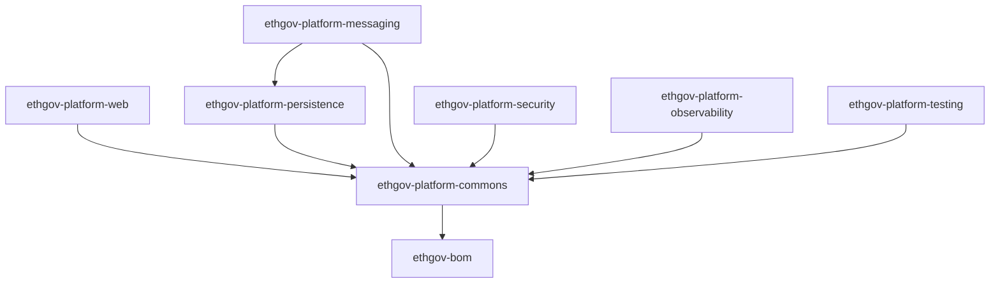

# Architecture overview — Phase 0

## Goals

Provide production-quality shared foundations so Phase 1 (Identity Platform) can start without inventing tenancy, errors, events, or localization.

## Module dependency graph

## Quality gates (Phase 0)

- Java 21 toolchain
- `-Werror` on compiler warnings
- JUnit 5 + AssertJ unit tests per module
- Jacoco reports generated on `check`
- SpotBugs plugin available via convention plugin
- ArchUnit rule library published for services
- Testcontainers image contracts fixed for PostGIS / Kafka / Redis

## Explicit non-goals

- No Identity service yet
- No REST business endpoints yet
- No 60-service scaffold
- No fake publishers or dummy repositories in production packages
